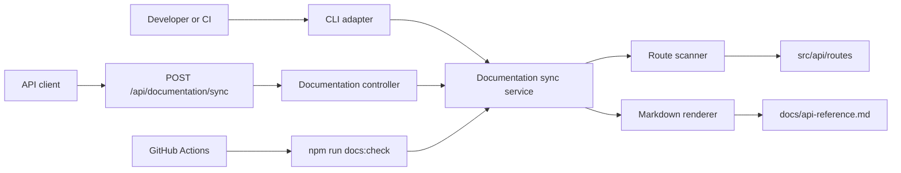

# Automated Documentation Sync - Architecture

## Recommendation

Use a deterministic in-process generator shared by an HTTP adapter and a CLI
adapter. Keep filesystem and parsing logic out of controllers so it can be
tested without MongoDB or a running server.

## Components

| Component | Responsibility |
|---|---|
| Documentation route/controller | Validate HTTP input, map domain errors to HTTP responses |
| Documentation sync service | Discover routes, render deterministic Markdown, compare and write output |
| CLI adapter | Run update or freshness-check modes and provide process exit status |
| Generated API reference | Version-controlled output consumed by maintainers |
| GitHub Actions workflow | Enforce build, test, lint, and documentation freshness |
| Copilot instructions/prompt | Keep future agent changes aligned with the sync workflow |

## Data flow

1. An API caller sends a title, or the CLI supplies the standard title.
2. The service validates its repository-controlled source directory.
3. Route files are read recursively and sorted.
4. static Express method/path declarations are normalized and sorted.
5. Markdown is rendered without volatile timestamps.
6. Sync mode compares then writes only changed content; check mode compares and
   fails if the file is absent or stale.
7. The adapter reports status without exposing stack traces.

## Technology choices

- Existing Express and TypeScript stack; no runtime dependency is added.
- Node `fs`, `path`, and `crypto` APIs for portable local processing.
- Jest for unit and filesystem integration tests.
- GitHub Actions for pull-request enforcement.

## Security and failure model

- Source/output paths are constructor configuration, never request input.
- Only `.ts` route files are parsed; dependencies and build output are ignored.
- Missing sources and read/write failures propagate as explicit typed errors.
- The HTTP adapter logs internal failures and returns a bounded message.
- Generated content contains repository-relative paths only.
